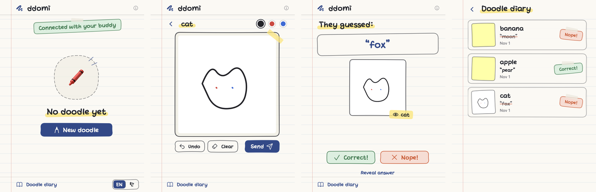
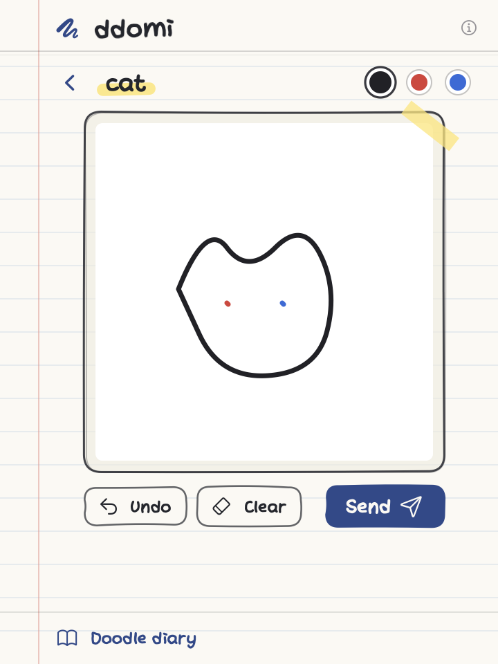
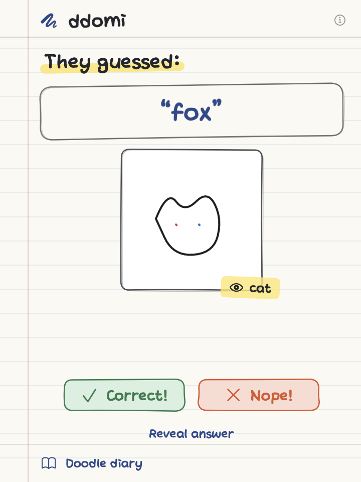
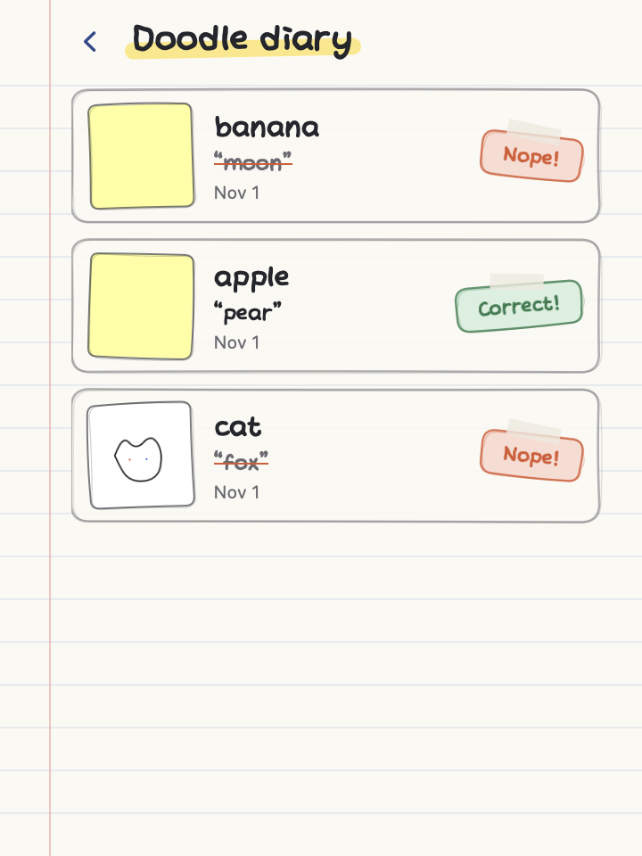

# ddomi

**A tiny doodle-guessing game for two, living in your Mac's menu bar.**

You draw something in a few strokes. Your buddy guesses what it is. You tell them if they got it. That is the whole game, and it fits in a sticky note.

[English](#what-it-is) · [한국어](#한국어-안내)



## What it is

ddomi is for two people who like each other and share a Mac-shaped corner of the internet: partners, close friends, a parent and a kid, two desk neighbors. There are no scores, timers or streaks. A round takes about a minute, and nobody is ever waiting on you.

| Draw | Judge | Diary |
| --- | --- | --- |
|  |  |  |

## Why you might like it

- **Made for two.** One room, one shared notepad. No feeds, no followers, no strangers.
- **Stays out of the way.** It lives in the menu bar and in a small floating sticky note. No notifications, no sounds, no Dock icon. Take a turn when you feel like it.
- **A minute a round.** Pick a word (or type your own), scribble it, send. Your buddy guesses; you say **Correct!** or **Nope!**, or reveal the answer.
- **Words in English or Korean.** Flip the `EN | 한` switch and the suggestions follow. You can always type your own word in any language.
- **A note with every doodle or guess.** Up to 30 characters, shown as a small sticky note on the other side. "Drew this on the train", "no idea, guessing".
- **A doodle diary.** Every finished round, with the drawing, the guesses, the notes and the result, piles up for both of you.
- **Up to three rooms.** A room per buddy, each with its own doodles, diary and nickname. Rooms are tabs under the title; the one with news gets a dot.
- **Private by design.** No account, no name, no email. Each Mac gets an anonymous ID, and the only things ever stored are your doodles, guesses, notes and results, visible to the two of you alone.
- **Free.** A hobby project, with no ads and nothing to buy.

## Requirements

- macOS 14 (Sonoma) or newer
- Apple silicon or Intel Mac (one build runs on both)
- An internet connection
- A buddy with a Mac who installs ddomi too (there is no phone or Windows version)

## Install

1. Open the [latest release](https://github.com/rkdsoon/ddomi-releases/releases/latest) and download `ddomi-<version>.zip`.
2. Double-click the zip. You get `ddomi.app`. Drag it into your **Applications** folder.
3. Open it. ddomi is not notarized by Apple (it is a hobby project), so macOS warns you the first time:
   - **macOS 15 or newer:** double-click the app and click **Done** on the warning. Open **System Settings → Privacy & Security**, scroll to the bottom, and click **Open Anyway** next to "ddomi". Confirm with your password or Touch ID.
   - **macOS 14:** right-click (or Control-click) `ddomi.app` in Applications and choose **Open**, then click **Open** in the dialog.
4. If macOS asks whether ddomi may use an item in your keychain, choose **Always Allow**. That is how it remembers who you are between launches.

You only do this once. From then on ddomi updates itself.

<details>
<summary>Prefer the Terminal?</summary>

Instead of step 3, run this once and then open the app normally:

```bash
xattr -dr com.apple.quarantine /Applications/ddomi.app
```

</details>

## First launch

A sticky-note window appears near the top-right corner of your screen, and a small scribble icon shows up in the menu bar.

- Drag the note by its top edge, just above the title, to move it. The drawing area itself does not move the window.
- Close the note with the red button when it is in the way. The app keeps running in the menu bar.
- Press **Option + Command + D** to bring the note back (or hide it again), or click the menu bar icon to open the same screen as a popover.
- Right-click the menu bar icon for **Show floating window**, **Check for updates…** and **Quit ddomi**.

## Pair with your buddy

The first thing ddomi shows you — on first launch, or whenever you press **+** for another room — is two equal choices: **Create a room** or **Join with a code**. Pick whichever fits what you've got; both of you need ddomi open.

1. **No code yet?** Click **Create a room**. You get a 6-character code and a **Send** button that opens the normal macOS share sheet, so you can hand it straight to your buddy over Messages, Mail or AirDrop. **Copy** still works if you'd rather paste it yourself.
2. **Got a code from your buddy?** Click **Join with a code**, type or paste it in, and press Return.
3. Both of you see **Connected with your buddy**, and ddomi asks what you call this person. The nickname stays on your Mac; your buddy never sees it, and you can change it later.

A code works for 24 hours and for one buddy, so pair soon after creating one. If it expires, just create a new one.

## Play

1. **New doodle.** Pick one of three suggested words, **Shuffle** for new ones, or type your own.
2. **Draw.** Three pen colors, **Undo**, **Clear**. Add a short note if you like. Then **Send**.
3. **Your buddy guesses.** They see your drawing and your note, and type a guess, with a note of their own if they want.
4. **You judge.** **Correct!** closes the round. **Nope!** sends it back for another guess; their wrong guesses pile up under the drawing. **Reveal answer** ends it and shows the word.
5. **Got it.** The guesser taps once to clear the result, and either of you can start the next doodle.

Only one doodle is in play per room at a time. If you both try to send at once, the second one is kept on your canvas so you can send it next.

## Rooms

Each buddy gets a room, up to three. Rooms show as tabs under the title, named with your nicknames; a tab with news gets a small dot.

- Press **+** next to the tabs to pair a new buddy.
- Right-click a tab to **Rename…** or **Leave room**.
- Leaving a room forgets it on your Mac. Your buddy keeps their diary, and the drawings you sent stay in it.

Each room is independent: its own rounds, its own diary, its own badge.

## Notes

When you send a doodle or a guess, there is a line under it that says **Add a note (optional)**. Type up to 30 characters and it travels with the doodle or guess as a small sticky note. Notes are kept in the diary too.

## Doodle diary

Open **Doodle diary** at the bottom of the note to browse every finished round in that room: the drawing, the word, who guessed what, the notes and the result. Both of you see the same diary.

## Updates

ddomi checks this repository for new versions every few hours while it is running and offers to install them. Accept, and it swaps itself out and relaunches; nothing to download or drag. You can also right-click the menu bar icon and choose **Check for updates…**. Release notes live under [Releases](https://github.com/rkdsoon/ddomi-releases/releases).

## Privacy and your data

- **No account.** When ddomi first starts it gets an anonymous ID from the server and keeps it in your Mac's keychain. That ID is the only thing that identifies you.
- **What leaves your Mac:** the doodles you send (as small images), the words you picked, guesses, notes and results. Nothing else: no name, no email, no contacts, no analytics.
- **Who can see it:** only the two members of a room. The server enforces this; a third person cannot read a room even with its code.
- **What stays on your Mac:** the list of your rooms and the nicknames you gave people. They are stored in `~/Library/Application Support/DoodleTrade`.
- **Delete it:** leave a room to forget it on your Mac. To delete everything, quit ddomi and remove `ddomi.app` and that folder. Rounds already in your buddy's diary stay there.

The server is a Firebase project run by the author. There is no web version and no way to log in from another device.

## FAQ

**Does my buddy need ddomi too?** Yes, on their own Mac. Send them this page.

**Can we play on an iPhone or Windows?** Not yet. ddomi is a Mac menu bar app only.

**Can more than two people share a room?** No. A room is always two people. For more friends, open more rooms (up to three).

**Can I use my own words?** Yes. The three suggestions are just a nudge; type anything in the field below them.

**Can we both draw at the same time?** One doodle is in play per room at a time. The second one waits on your canvas until the round ends.

**Does it work offline?** It needs the internet to send and receive. If you go offline mid-round, nothing is lost; the round continues when you reconnect.

**Is it free?** Yes. No ads, no purchases, no subscriptions.

**Where is the Dock icon?** There is none, on purpose. ddomi lives in the menu bar and the floating note. Quit it from the menu bar icon's right-click menu.

## Troubleshooting

**I cannot find the menu bar icon.** Menu bar tidying apps (Hidden Bar, Bartender, Ice) often tuck new icons away, and a notch can hide them too. Press **Option + Command + D** to open the floating note; it works without the icon.

**"Open Anyway" is missing.** It only appears after you have tried to open the app once. Double-click the app again, then return to Privacy & Security.

**Nothing happens when I double-click the app.** Finish the "Open Anyway" steps above, or use the Terminal command under Install. Then open it again; a sticky note should appear near the top-right of your screen.

**The keychain dialog keeps appearing.** Choose **Always Allow**, not **Allow**.

**My buddy's code says it has expired.** Codes last 24 hours. Ask them to click **Create a room** again and send the new code.

**After an update it forgot our pair.** Click **Reconnect**. It restores the pairing without a new code.

**I sent a doodle but my buddy sees nothing.** Make sure they are in the same room (the tab with your name) and online. The screen refreshes by itself; if it does not within a few seconds, close and reopen the note.

**I want to start over.** Right-click each tab and choose **Leave room**, then pair again with a new code.

**Something else?** Open an issue in this repository and describe what you saw.

---

## 한국어 안내

**둘이서 하는 작은 낙서 맞히기 게임, 맥 메뉴 막대에 삽니다.**

내가 몇 획으로 그림을 그리면, 상대가 그게 뭔지 맞힙니다. 맞았는지 아닌지는 내가 알려 주고요. 게임은 그게 전부이고, 메모지 한 장 크기 안에 다 들어갑니다.

### 어떤 앱인가요

ddomi(또미)는 서로 가까운 두 사람을 위한 앱입니다. 연인, 친한 친구, 부모와 아이, 옆자리 동료. 점수도 타이머도 연속 기록도 없습니다. 한 판에 1분 정도 걸리고, 누구도 상대를 기다리게 하지 않습니다.

- **딱 두 사람.** 방 하나에 둘이 쓰는 메모장 하나. 피드도, 팔로워도, 모르는 사람도 없습니다.
- **방해하지 않습니다.** 메뉴 막대와 작은 메모지 창에서만 돌아갑니다. 알림·소리·Dock 아이콘이 없어서, 생각날 때 한 판씩 하면 됩니다.
- **한 판에 1분.** 단어를 고르고(직접 써도 됩니다) 슥슥 그려서 보냅니다. 상대가 답을 쓰면 **Correct!**(정답) / **Nope!**(땡) 을 누르거나, **Reveal answer**(정답 공개)로 끝냅니다.
- **영어·한국어 단어.** `EN | 한` 스위치를 바꾸면 추천 단어가 바뀝니다. 어떤 언어든 직접 입력할 수도 있습니다.
- **그림과 답에 메모 한 줄.** 최대 30자. 상대 화면에 작은 포스트잇처럼 붙습니다. "지하철에서 그림", "모르겠어서 찍음" 같은 말을 함께 보낼 수 있습니다.
- **낙서 일기.** 끝난 판은 그림·답·메모·결과가 함께 쌓여서 둘이 같이 봅니다.
- **방은 최대 3개.** 친구마다 방 하나. 방마다 그림, 일기, 별명이 따로입니다. 제목 아래 탭으로 보이고, 새 소식이 있는 탭에는 점이 찍힙니다.
- **개인정보를 받지 않습니다.** 계정도, 이름도, 이메일도 없습니다. 맥마다 익명 ID 하나가 생기고, 저장되는 건 그림·답·메모·결과뿐이며 그 방의 두 사람만 볼 수 있습니다.
- **무료.** 취미 프로젝트입니다. 광고도 결제도 없습니다.

### 필요한 것

- macOS 14 (Sonoma) 이상
- Apple silicon 또는 Intel 맥 (하나의 빌드로 둘 다 실행)
- 인터넷 연결
- 맥을 쓰는 친구 한 명 (친구도 설치해야 합니다. 아이폰·윈도우 버전은 없습니다)

### 설치

1. [최신 릴리스](https://github.com/rkdsoon/ddomi-releases/releases/latest)에서 `ddomi-<버전>.zip`을 내려받습니다.
2. zip을 더블클릭해 풀면 `ddomi.app`이 나옵니다. **응용 프로그램** 폴더로 끌어다 놓습니다.
3. 앱을 엽니다. ddomi는 Apple 공증(notarization)을 받지 않은 취미 앱이라 처음 한 번은 macOS가 경고를 띄웁니다.
   - **macOS 15 이상:** 앱을 더블클릭하고 경고 창에서 **완료**를 누릅니다. **시스템 설정 → 개인정보 보호 및 보안**을 열어 맨 아래로 내려가면 "ddomi"가 차단되었다는 안내 옆에 **그래도 열기** 버튼이 있습니다. 누르고 암호나 Touch ID로 확인합니다.
   - **macOS 14:** 응용 프로그램 폴더에서 `ddomi.app`을 우클릭(또는 Control+클릭) → **열기**, 그다음 대화 상자에서 다시 **열기**.
4. ddomi가 키체인 항목을 사용해도 되는지 묻는 창이 뜨면 **항상 허용**을 누릅니다. 다음에 켰을 때 나를 기억하는 방법입니다.

이 과정은 처음 한 번뿐입니다. 이후 업데이트는 앱이 스스로 합니다.

<details>
<summary>터미널이 편하다면</summary>

3번 대신 아래 명령을 한 번 실행하고 평소처럼 앱을 열면 됩니다.

```bash
xattr -dr com.apple.quarantine /Applications/ddomi.app
```

</details>

### 처음 켜면

화면 오른쪽 위에 메모지 창이 하나 뜨고, 메뉴 막대에 작은 낙서 모양 아이콘이 생깁니다.

- 메모지는 **제목 바로 위 가장자리**를 잡고 끕니다. 그림 영역을 끌어도 창은 움직이지 않습니다.
- 거슬리면 빨간 버튼으로 닫으세요. 앱은 메뉴 막대에서 계속 돌아갑니다.
- **Option + Command + D** 를 누르면 메모지가 다시 나타납니다(한 번 더 누르면 숨김). 메뉴 막대 아이콘을 클릭하면 같은 화면이 팝오버로 열립니다.
- 메뉴 막대 아이콘을 우클릭하면 **Show floating window**(메모지 창 보기), **Check for updates…**(업데이트 확인), **Quit ddomi**(종료)가 있습니다.

### 친구와 연결하기

ddomi를 처음 열었을 때(또는 **+** 로 새 방을 추가할 때) 가장 먼저 보이는 건 **Create a room**(방 만들기)과 **Join with a code**(코드로 참여) 두 가지, 동급으로 놓인 선택지입니다. 자기 상황에 맞는 쪽을 고르면 되고, 두 사람 모두 ddomi를 켠 상태여야 합니다.

1. **코드가 없다면?** **Create a room**을 누르세요. 6자리 코드와 함께 **Send**(보내기) 버튼이 뜨는데, 누르면 macOS 공유 시트가 열려서 메시지·메일·AirDrop으로 바로 친구에게 전달할 수 있습니다. 직접 붙여넣고 싶으면 **Copy**도 그대로 있습니다.
2. **친구한테 코드를 받았다면?** **Join with a code**를 누르고 코드를 입력하거나 붙여넣은 뒤 Return을 누릅니다.
3. 둘 다 **Connected with your buddy**(친구와 연결됨)가 보이면 성공입니다. 이어서 상대를 뭐라고 부를지 묻는데, 이 별명은 내 맥에만 저장되고 상대에게는 보이지 않습니다. 나중에 바꿀 수 있습니다.

코드는 **24시간** 동안, 한 사람에게만 유효합니다. 만들고 나서 바로 연결하세요. 만료되면 새로 만들면 됩니다.

### 플레이

1. **New doodle**(새 낙서). 추천 단어 셋 중 하나를 고르거나, **Shuffle**로 다른 단어를 받거나, 아래 칸에 직접 씁니다.
2. **그리기.** 펜 색 3가지, **Undo**(되돌리기), **Clear**(모두 지우기). 원하면 메모 한 줄을 붙이고 **Send**(보내기).
3. **상대가 맞힙니다.** 내 그림과 메모를 보고 답을 쓰고, 원하면 자기 메모도 붙입니다.
4. **내가 판정합니다.** **Correct!**(정답)를 누르면 판이 끝납니다. **Nope!**(땡)는 다시 맞히라고 돌려보내고, 틀린 답은 그림 아래에 쌓입니다. **Reveal answer**(정답 공개)는 판을 끝내고 단어를 보여 줍니다.
5. **Got it**(확인). 맞히던 사람이 한 번 눌러 결과를 치우면, 둘 중 아무나 다음 낙서를 시작할 수 있습니다.

한 방에서는 한 번에 그림 하나만 진행됩니다. 둘이 동시에 보내려 하면 나중 그림은 내 캔버스에 남아 있다가 다음에 보낼 수 있습니다.

### 방

친구마다 방 하나, 최대 3개입니다. 방은 제목 아래 탭으로 보이고 내가 지은 별명이 이름이 됩니다. 새 소식이 있는 탭에는 작은 점이 찍힙니다.

- 탭 옆 **+** 를 누르면 새 친구와 연결할 수 있습니다.
- 탭을 우클릭하면 **Rename…**(별명 바꾸기)과 **Leave room**(방 나가기)이 있습니다.
- 방을 나가면 내 맥에서만 잊힙니다. 상대의 일기는 그대로 남고, 내가 보낸 그림도 거기 남습니다.

방은 서로 독립적입니다. 진행 중인 판, 일기, 알림 점이 모두 따로입니다.

### 메모

그림이나 답을 보낼 때 아래에 **Add a note (optional)**(메모 추가, 선택) 칸이 있습니다. 최대 30자까지 쓰면 그림·답과 함께 작은 포스트잇으로 상대 화면에 붙습니다. 메모는 일기에도 남습니다.

### 낙서 일기

메모지 아래쪽의 **Doodle diary**(낙서 일기)를 열면 그 방에서 끝난 판을 모두 볼 수 있습니다. 그림, 단어, 누가 뭐라고 답했는지, 메모, 결과. 두 사람이 같은 일기를 봅니다.

### 업데이트

ddomi는 켜져 있는 동안 몇 시간에 한 번씩 이 저장소에서 새 버전을 확인하고, 있으면 설치할지 묻습니다. 수락하면 앱이 스스로 교체되고 다시 켜집니다. 내려받거나 끌어다 놓을 것이 없습니다. 메뉴 막대 아이콘 우클릭 → **Check for updates…** 로 바로 확인할 수도 있습니다. 변경 내용은 [Releases](https://github.com/rkdsoon/ddomi-releases/releases)에 있습니다.

### 개인정보와 데이터

- **계정이 없습니다.** 처음 켤 때 서버에서 익명 ID를 하나 받아 맥의 키체인에 보관합니다. 나를 구분하는 건 이 ID뿐입니다.
- **맥 밖으로 나가는 것:** 내가 보낸 그림(작은 이미지), 고른 단어, 답, 메모, 결과. 그 외에는 없습니다. 이름·이메일·연락처·사용 통계를 보내지 않습니다.
- **볼 수 있는 사람:** 그 방의 두 사람뿐입니다. 서버가 이를 강제하므로, 코드를 알아도 제3자는 방을 읽을 수 없습니다.
- **맥에만 남는 것:** 내 방 목록과 내가 지은 별명. `~/Library/Application Support/DoodleTrade` 폴더에 있습니다.
- **지우기:** 방을 나가면 내 맥에서 잊힙니다. 전부 지우려면 ddomi를 종료하고 `ddomi.app`과 위 폴더를 삭제하세요. 상대 일기에 이미 쌓인 판은 그대로 남습니다.

서버는 제작자가 운영하는 Firebase 프로젝트입니다. 웹 버전은 없고, 다른 기기에서 로그인하는 방법도 없습니다.

### 자주 묻는 질문

**친구도 ddomi를 깔아야 하나요?** 네, 친구의 맥에 설치해야 합니다. 이 페이지를 보내 주세요.

**아이폰이나 윈도우에서도 되나요?** 아직 안 됩니다. 맥 메뉴 막대 앱뿐입니다.

**한 방에 셋 이상 들어갈 수 있나요?** 아니요. 방은 항상 두 사람입니다. 친구가 더 있으면 방을 더 여세요(최대 3개).

**내 단어를 써도 되나요?** 네. 추천 단어 셋은 힌트일 뿐이고, 아래 칸에 아무 단어나 쓰면 됩니다.

**둘이 동시에 그려도 되나요?** 한 방에서는 한 번에 그림 하나만 진행됩니다. 나중 그림은 판이 끝날 때까지 캔버스에 남아 있습니다.

**오프라인에서도 되나요?** 보내고 받으려면 인터넷이 필요합니다. 판 중간에 연결이 끊겨도 잃는 건 없고, 다시 연결되면 이어집니다.

**유료인가요?** 무료입니다. 광고·결제·구독이 없습니다.

**Dock 아이콘이 왜 없나요?** 일부러 없습니다. ddomi는 메뉴 막대와 메모지 창에서만 삽니다. 종료는 메뉴 막대 아이콘 우클릭 메뉴에서 합니다.

**한글이 깨지거나 폰트가 다른가요?** 한글 단어는 앱에 들어 있는 히피체로 표시됩니다. 별도 설치가 필요 없습니다.

### 문제가 생기면

**메뉴 막대 아이콘이 안 보여요.** Hidden Bar, Bartender, Ice 같은 메뉴 막대 정리 앱이 새 아이콘을 숨기는 경우가 많고, 노치 뒤에 가려지기도 합니다. **Option + Command + D** 를 누르면 아이콘 없이도 메모지 창이 열립니다.

**"그래도 열기" 버튼이 없어요.** 앱을 한 번 열어 보려고 시도한 뒤에만 나타납니다. 앱을 다시 더블클릭하고 개인정보 보호 및 보안으로 돌아가세요.

**앱을 더블클릭해도 아무 반응이 없어요.** 위의 "그래도 열기" 과정을 끝내거나, 설치 항목의 터미널 명령을 쓰세요. 그다음 다시 열면 화면 오른쪽 위에 메모지가 떠야 합니다.

**키체인 창이 계속 떠요.** **허용**이 아니라 **항상 허용**을 누르세요.

**코드가 만료됐다고 나와요.** 코드는 24시간만 유효합니다. 친구에게 **Create a room**을 다시 눌러 새 코드를 보내 달라고 하세요.

**업데이트 후 연결이 사라졌어요.** **Reconnect**(다시 연결)를 누르세요. 새 코드 없이 연결을 복구합니다.

**그림을 보냈는데 친구 화면에 안 떠요.** 친구가 같은 방(내 별명이 붙은 탭)에 있고 인터넷에 연결돼 있는지 확인하세요. 화면은 자동으로 갱신됩니다. 몇 초가 지나도 그대로면 메모지를 닫았다가 다시 여세요.

**처음부터 다시 하고 싶어요.** 탭마다 우클릭 → **Leave room**으로 나간 뒤, 새 코드로 다시 연결하세요.

**다른 문제가 있나요?** 이 저장소에 이슈를 남겨 주세요. 어떤 화면에서 무엇을 봤는지 적어 주시면 도움이 됩니다.
